<div align="center">


**Architecting full-stack and deep learning Systems.**


</div>

---

## `~/stack`

```
LANGUAGES / LEVEL
──────────────────────────────────────────────
JavaScript    [███████████████████░]  expert
TypeScript    [█████████████████░░░]  advanced
Python        [████████████████░░░░]  advanced
Deep Learning [███████████████░░░░░]  advanced
Java          [█████████░░░░░░░░░░░░]  intermediate
HTML/CSS      [████████░░░░░░░░░░░░░]  intermediate

FRAMEWORKS
──────────────────────────────────────────────
Node · Express · React · MongoDB
Flask · PyTorch · Phi-2 · BLIP · Whisper
Jupyter · Docker
```

## `~/projects`

<pre>
~/projects
├── <a href="https://github.com/dhruvbhadhotiya/OwnSquare">OwnSquare</a>
│   PropTech/FinTech platform — fractional
│   property investment, wallets, portfolios,
│   sale payouts. Role-based Admin / Broker /
│   Investor. MERN.
├── <a href="https://github.com/dhruvbhadhotiya/NOVA">NOVA</a>
│   Multimodal AI classroom assistant that
│   runs fully offline: Phi-2 answers, BLIP
│   captions, Whisper transcripts. Flask
│   backend, vanilla-JS frontend.
├── <a href="https://github.com/dhruvbhadhotiya/payora">Payora</a>
│   AI-powered parametric income insurance
│   for India's gig economy.
└── <a href="https://github.com/dhruvbhadhotiya/WebJava">WebJava</a>
    Java code runner — compiles and executes
    snippets in Node or the browser.

31 public repos · 7 followers · <a href="https://github.com/dhruvbhadhotiya?tab=repositories">everything →</a>
</pre>

## `~/activity`

<div align="center">

<picture>
  <source media="(prefers-color-scheme: dark)" srcset="assets/amber-dark.svg">
  <source media="(prefers-color-scheme: light)" srcset="assets/amber-light.svg">
  
</picture>


</div>

---

<div align="center">

```
 ██████╗  ██╗   ██╗██╗   ██╗██╗   ██╗
 ██╔══██╗ ╚██╗ ██╔╝██║   ██║██║   ██║
 ██║  ██║  ╚████╔╝ ██║   ██║██║   ██║
 ██║  ██║   ╚██╔╝  ██║   ██║╚███ ██╔╝
 ██████╔╝    ██║   ╚██████╔╝ ╚████╔╝
 ╚═════╝     ╚═╝    ╚═════╝   ╚═══╝
```

> <!-- quote:start -->
> Any sufficiently advanced technology is indistinguishable from magic. — Arthur C. Clarke
> <!-- quote:end -->

`./contact.sh` → [dhruvbhadhotiya@gmail.com](mailto:dhruvbhadhotiya@gmail.com) · [LinkedIn](https://www.linkedin.com/in/dhruv-bhadhotiya) · [X](https://x.com/DhruvBhadhotiya) · portfolio: *coming soon*

`./whereami.sh` → India

</div>