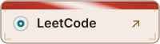
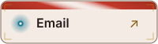
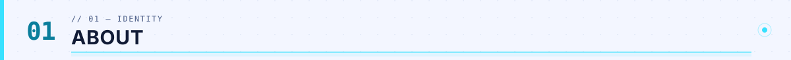
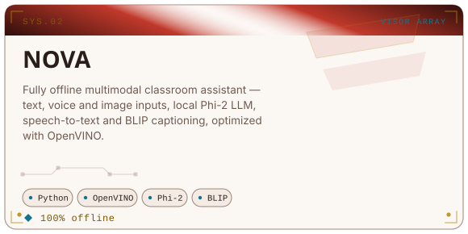
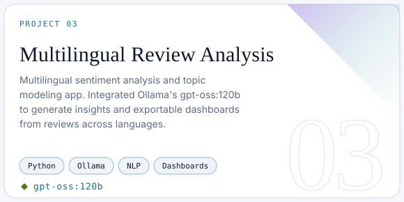
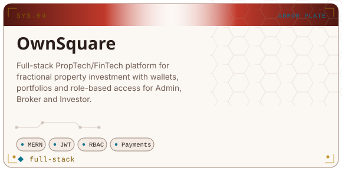
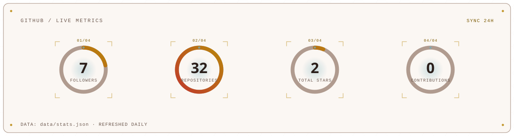
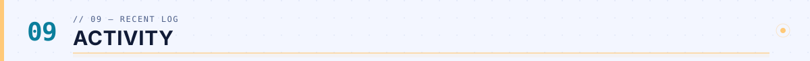
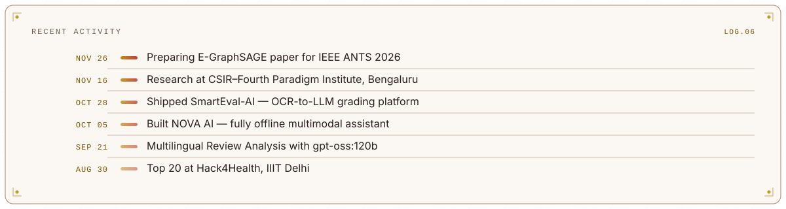

<!--
  GENERATED FILE — do not edit by hand.
  Produced by scripts/generate-readme.mjs from data/profile.json and data/stats.json.
  Every rebuild overwrites this file; only the BEGIN/END marker blocks are meant
  to be replaced by automation.
-->

<picture><source media="(prefers-color-scheme: dark)" srcset="https://raw.githubusercontent.com/dhruvbhadhotiya/dhruvbhadhotiya/main/assets/hero-dark.svg"></picture>

<a href="https://github.com/dhruvbhadhotiya"><picture><source media="(prefers-color-scheme: dark)" srcset="https://raw.githubusercontent.com/dhruvbhadhotiya/dhruvbhadhotiya/main/assets/button-github-dark.svg"></picture></a>
<a href="https://linkedin.com/in/dhruv-bhadhotiya"><picture><source media="(prefers-color-scheme: dark)" srcset="https://raw.githubusercontent.com/dhruvbhadhotiya/dhruvbhadhotiya/main/assets/button-linkedin-dark.svg"></picture></a>
<a href="https://leetcode.com/u/dhruvbhadhotiya"><picture><source media="(prefers-color-scheme: dark)" srcset="https://raw.githubusercontent.com/dhruvbhadhotiya/dhruvbhadhotiya/main/assets/button-leetcode-dark.svg"></picture></a>
<a href="mailto:dhruvbhadhotiya@gmail.com"><picture><source media="(prefers-color-scheme: dark)" srcset="https://raw.githubusercontent.com/dhruvbhadhotiya/dhruvbhadhotiya/main/assets/button-email-dark.svg"></picture></a>

 

<picture><source media="(prefers-color-scheme: dark)" srcset="https://raw.githubusercontent.com/dhruvbhadhotiya/dhruvbhadhotiya/main/assets/header-about-dark.svg"></picture>

<picture><source media="(prefers-color-scheme: dark)" srcset="https://raw.githubusercontent.com/dhruvbhadhotiya/dhruvbhadhotiya/main/assets/card-about-dark.svg"></picture>

 

<picture><source media="(prefers-color-scheme: dark)" srcset="https://raw.githubusercontent.com/dhruvbhadhotiya/dhruvbhadhotiya/main/assets/header-now-dark.svg"></picture>

<picture><source media="(prefers-color-scheme: dark)" srcset="https://raw.githubusercontent.com/dhruvbhadhotiya/dhruvbhadhotiya/main/assets/card-now-dark.svg"></picture>

 

<picture><source media="(prefers-color-scheme: dark)" srcset="https://raw.githubusercontent.com/dhruvbhadhotiya/dhruvbhadhotiya/main/assets/header-work-dark.svg"></picture>

<a href="https://github.com/dhruvbhadhotiya"><picture><source media="(prefers-color-scheme: dark)" srcset="https://raw.githubusercontent.com/dhruvbhadhotiya/dhruvbhadhotiya/main/assets/project-1-dark.svg"></picture></a>
<a href="https://github.com/dhruvbhadhotiya"><picture><source media="(prefers-color-scheme: dark)" srcset="https://raw.githubusercontent.com/dhruvbhadhotiya/dhruvbhadhotiya/main/assets/project-2-dark.svg"></picture></a> 
<a href="https://github.com/dhruvbhadhotiya"><picture><source media="(prefers-color-scheme: dark)" srcset="https://raw.githubusercontent.com/dhruvbhadhotiya/dhruvbhadhotiya/main/assets/project-3-dark.svg"></picture></a>
<a href="https://github.com/dhruvbhadhotiya"><picture><source media="(prefers-color-scheme: dark)" srcset="https://raw.githubusercontent.com/dhruvbhadhotiya/dhruvbhadhotiya/main/assets/project-4-dark.svg"></picture></a>

 

<picture><source media="(prefers-color-scheme: dark)" srcset="https://raw.githubusercontent.com/dhruvbhadhotiya/dhruvbhadhotiya/main/assets/header-toolbox-dark.svg"></picture>

<picture><source media="(prefers-color-scheme: dark)" srcset="https://raw.githubusercontent.com/dhruvbhadhotiya/dhruvbhadhotiya/main/assets/card-toolbox-dark.svg"></picture>

 

<picture><source media="(prefers-color-scheme: dark)" srcset="https://raw.githubusercontent.com/dhruvbhadhotiya/dhruvbhadhotiya/main/assets/header-milestones-dark.svg"></picture>

<picture><source media="(prefers-color-scheme: dark)" srcset="https://raw.githubusercontent.com/dhruvbhadhotiya/dhruvbhadhotiya/main/assets/card-milestones-dark.svg"></picture>

 

<!-- BEGIN:live -->

<picture><source media="(prefers-color-scheme: dark)" srcset="https://raw.githubusercontent.com/dhruvbhadhotiya/dhruvbhadhotiya/main/assets/header-contributions-dark.svg"></picture>

<a href="https://github.com/dhruvbhadhotiya"><picture><source media="(prefers-color-scheme: dark)" srcset="https://raw.githubusercontent.com/dhruvbhadhotiya/dhruvbhadhotiya/main/assets/live-github-dark.svg"></picture></a>

<picture><source media="(prefers-color-scheme: dark)" srcset="https://raw.githubusercontent.com/dhruvbhadhotiya/dhruvbhadhotiya/main/assets/header-problem-solving-dark.svg"></picture>

<a href="https://leetcode.com/u/dhruvbhadhotiya"><picture><source media="(prefers-color-scheme: dark)" srcset="https://raw.githubusercontent.com/dhruvbhadhotiya/dhruvbhadhotiya/main/assets/live-leetcode-dark.svg"></picture></a>

<picture><source media="(prefers-color-scheme: dark)" srcset="https://raw.githubusercontent.com/dhruvbhadhotiya/dhruvbhadhotiya/main/assets/header-activity-dark.svg"></picture>

<picture><source media="(prefers-color-scheme: dark)" srcset="https://raw.githubusercontent.com/dhruvbhadhotiya/dhruvbhadhotiya/main/assets/live-activity-dark.svg"></picture>

<!-- END:live -->

<!-- BEGIN:activity -->
- <code>NOV 26</code>&nbsp; Preparing E-GraphSAGE paper for IEEE ANTS 2026
- <code>NOV 16</code>&nbsp; Research at CSIR–Fourth Paradigm Institute, Bengaluru
- <code>OCT 28</code>&nbsp; Shipped SmartEval-AI — OCR-to-LLM grading platform
- <code>OCT 05</code>&nbsp; Built NOVA AI — fully offline multimodal assistant
- <code>SEP 21</code>&nbsp; Multilingual Review Analysis with gpt-oss:120b
- <code>AUG 30</code>&nbsp; Top 20 at Hack4Health, IIIT Delhi
<!-- END:activity -->

 

<picture><source media="(prefers-color-scheme: dark)" srcset="https://raw.githubusercontent.com/dhruvbhadhotiya/dhruvbhadhotiya/main/assets/header-contact-dark.svg"></picture>

<picture><source media="(prefers-color-scheme: dark)" srcset="https://raw.githubusercontent.com/dhruvbhadhotiya/dhruvbhadhotiya/main/assets/footer-dark.svg"></picture>

