<!--
  GENERATED FILE — do not edit by hand.
  Produced by scripts/generate-readme.mjs from data/profile.json, data/stats.json,
  data/ttt.json and game/engine.mjs. Every rebuild overwrites this file; only the
  BEGIN/END marker blocks are meant to be replaced by automation.
-->

<picture><source media="(prefers-color-scheme: dark)" srcset="https://raw.githubusercontent.com/dhruvbhadhotiya/dhruvbhadhotiya/main/assets/hero-dark.svg"></picture>

<a href="https://github.com/dhruvbhadhotiya"><picture><source media="(prefers-color-scheme: dark)" srcset="https://raw.githubusercontent.com/dhruvbhadhotiya/dhruvbhadhotiya/main/assets/button-github-dark.svg"></picture></a>
<a href="https://linkedin.com/in/dhruv-bhadhotiya"><picture><source media="(prefers-color-scheme: dark)" srcset="https://raw.githubusercontent.com/dhruvbhadhotiya/dhruvbhadhotiya/main/assets/button-linkedin-dark.svg"></picture></a>
<a href="https://leetcode.com/u/dhruvbhadhotiya"><picture><source media="(prefers-color-scheme: dark)" srcset="https://raw.githubusercontent.com/dhruvbhadhotiya/dhruvbhadhotiya/main/assets/button-leetcode-dark.svg"></picture></a>
<a href="mailto:dhruvbhadhotiya@gmail.com"><picture><source media="(prefers-color-scheme: dark)" srcset="https://raw.githubusercontent.com/dhruvbhadhotiya/dhruvbhadhotiya/main/assets/button-email-dark.svg"></picture></a>

 

<picture><source media="(prefers-color-scheme: dark)" srcset="https://raw.githubusercontent.com/dhruvbhadhotiya/dhruvbhadhotiya/main/assets/header-about-dark.svg"></picture>

<picture><source media="(prefers-color-scheme: dark)" srcset="https://raw.githubusercontent.com/dhruvbhadhotiya/dhruvbhadhotiya/main/assets/card-about-dark.svg">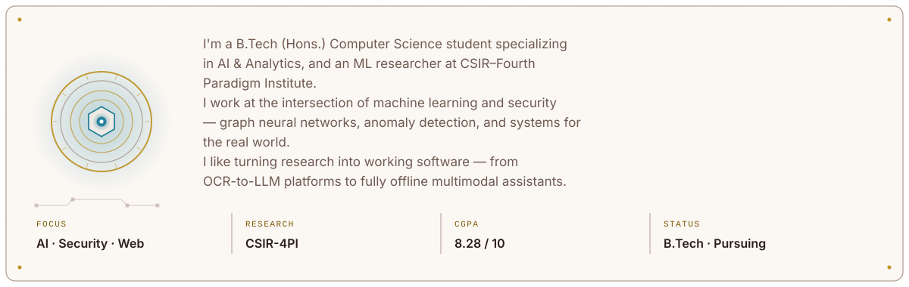</picture>

 

<picture><source media="(prefers-color-scheme: dark)" srcset="https://raw.githubusercontent.com/dhruvbhadhotiya/dhruvbhadhotiya/main/assets/header-now-dark.svg"></picture>

<picture><source media="(prefers-color-scheme: dark)" srcset="https://raw.githubusercontent.com/dhruvbhadhotiya/dhruvbhadhotiya/main/assets/card-now-dark.svg">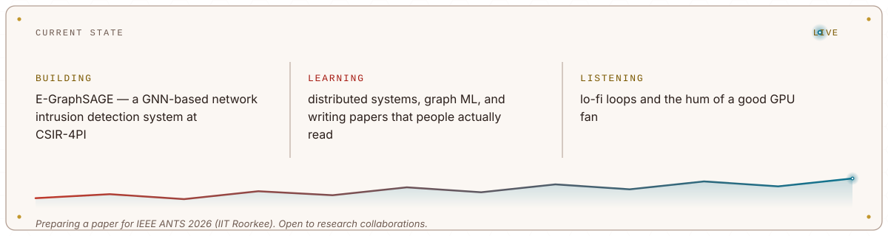</picture>

 

<picture><source media="(prefers-color-scheme: dark)" srcset="https://raw.githubusercontent.com/dhruvbhadhotiya/dhruvbhadhotiya/main/assets/header-work-dark.svg">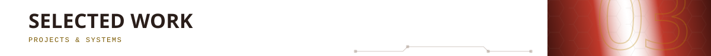</picture>

<a href="https://github.com/dhruvbhadhotiya"><picture><source media="(prefers-color-scheme: dark)" srcset="https://raw.githubusercontent.com/dhruvbhadhotiya/dhruvbhadhotiya/main/assets/project-1-dark.svg">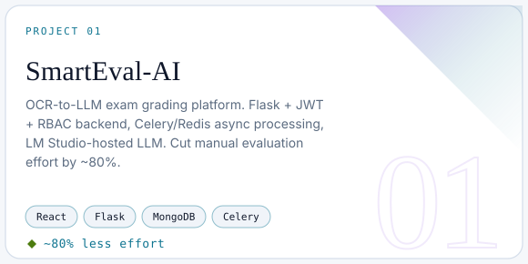</picture></a>
<a href="https://github.com/dhruvbhadhotiya"><picture><source media="(prefers-color-scheme: dark)" srcset="https://raw.githubusercontent.com/dhruvbhadhotiya/dhruvbhadhotiya/main/assets/project-2-dark.svg"></picture></a> 
<a href="https://github.com/dhruvbhadhotiya"><picture><source media="(prefers-color-scheme: dark)" srcset="https://raw.githubusercontent.com/dhruvbhadhotiya/dhruvbhadhotiya/main/assets/project-3-dark.svg"></picture></a>
<a href="https://github.com/dhruvbhadhotiya"><picture><source media="(prefers-color-scheme: dark)" srcset="https://raw.githubusercontent.com/dhruvbhadhotiya/dhruvbhadhotiya/main/assets/project-4-dark.svg"></picture></a>

 

<picture><source media="(prefers-color-scheme: dark)" srcset="https://raw.githubusercontent.com/dhruvbhadhotiya/dhruvbhadhotiya/main/assets/header-toolbox-dark.svg">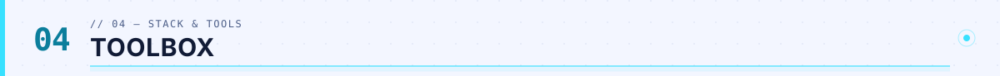</picture>

<picture><source media="(prefers-color-scheme: dark)" srcset="https://raw.githubusercontent.com/dhruvbhadhotiya/dhruvbhadhotiya/main/assets/card-toolbox-dark.svg">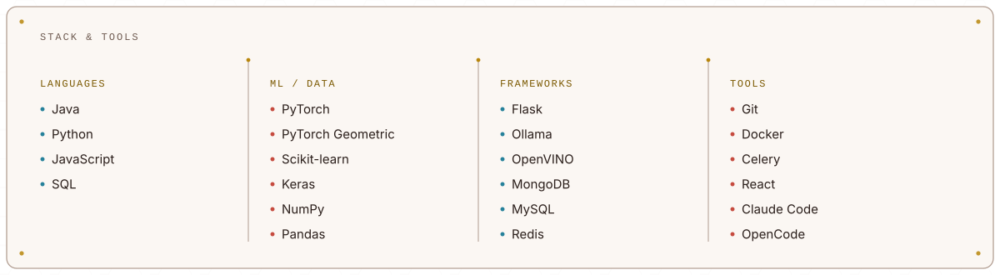</picture>

 

<picture><source media="(prefers-color-scheme: dark)" srcset="https://raw.githubusercontent.com/dhruvbhadhotiya/dhruvbhadhotiya/main/assets/header-milestones-dark.svg"></picture>

<picture><source media="(prefers-color-scheme: dark)" srcset="https://raw.githubusercontent.com/dhruvbhadhotiya/dhruvbhadhotiya/main/assets/card-milestones-dark.svg">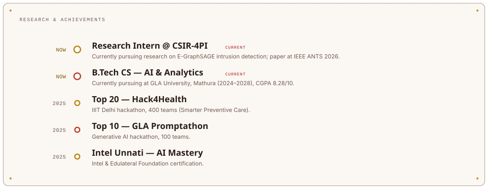</picture>

 

<picture><source media="(prefers-color-scheme: dark)" srcset="https://raw.githubusercontent.com/dhruvbhadhotiya/dhruvbhadhotiya/main/assets/header-contributions-dark.svg"></picture>

<!-- BEGIN:live -->
<a href="https://github.com/dhruvbhadhotiya"><picture><source media="(prefers-color-scheme: dark)" srcset="https://raw.githubusercontent.com/dhruvbhadhotiya/dhruvbhadhotiya/main/assets/live-github-dark.svg"></picture></a>

<picture><source media="(prefers-color-scheme: dark)" srcset="https://raw.githubusercontent.com/dhruvbhadhotiya/dhruvbhadhotiya/main/assets/header-problem-solving-dark.svg">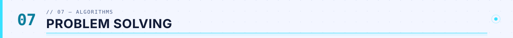</picture>

<a href="https://leetcode.com/u/dhruvbhadhotiya"><picture><source media="(prefers-color-scheme: dark)" srcset="https://raw.githubusercontent.com/dhruvbhadhotiya/dhruvbhadhotiya/main/assets/live-leetcode-dark.svg">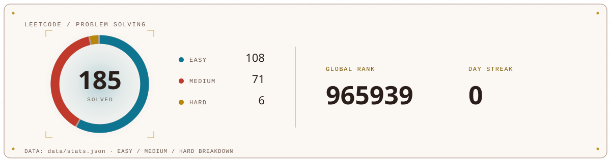</picture></a>

<picture><source media="(prefers-color-scheme: dark)" srcset="https://raw.githubusercontent.com/dhruvbhadhotiya/dhruvbhadhotiya/main/assets/header-play-dark.svg">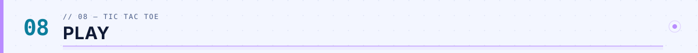</picture>

<!-- BEGIN:ttt -->

<a href="https://github.com/dhruvbhadhotiya/dhruvbhadhotiya/issues/new?title=ttt%7Cmove%7C0&amp;body=Just%20press%20%22Create%22.%20A%20GitHub%20Action%20plays%20the%20AI&#39;s%20reply%20and%20refreshes%20the%20board%20on%20the%20profile%20within%20a%20minute."><picture><source media="(prefers-color-scheme: dark)" srcset="https://raw.githubusercontent.com/dhruvbhadhotiya/dhruvbhadhotiya/main/assets/ttt/empty-dark.svg"></picture></a><a href="https://github.com/dhruvbhadhotiya/dhruvbhadhotiya/issues/new?title=ttt%7Cmove%7C1&amp;body=Just%20press%20%22Create%22.%20A%20GitHub%20Action%20plays%20the%20AI&#39;s%20reply%20and%20refreshes%20the%20board%20on%20the%20profile%20within%20a%20minute."><picture><source media="(prefers-color-scheme: dark)" srcset="https://raw.githubusercontent.com/dhruvbhadhotiya/dhruvbhadhotiya/main/assets/ttt/empty-dark.svg"></picture></a><a href="https://github.com/dhruvbhadhotiya/dhruvbhadhotiya/issues/new?title=ttt%7Cmove%7C2&amp;body=Just%20press%20%22Create%22.%20A%20GitHub%20Action%20plays%20the%20AI&#39;s%20reply%20and%20refreshes%20the%20board%20on%20the%20profile%20within%20a%20minute."><picture><source media="(prefers-color-scheme: dark)" srcset="https://raw.githubusercontent.com/dhruvbhadhotiya/dhruvbhadhotiya/main/assets/ttt/empty-dark.svg"></picture></a> 
<a href="https://github.com/dhruvbhadhotiya/dhruvbhadhotiya/issues/new?title=ttt%7Cmove%7C3&amp;body=Just%20press%20%22Create%22.%20A%20GitHub%20Action%20plays%20the%20AI&#39;s%20reply%20and%20refreshes%20the%20board%20on%20the%20profile%20within%20a%20minute."><picture><source media="(prefers-color-scheme: dark)" srcset="https://raw.githubusercontent.com/dhruvbhadhotiya/dhruvbhadhotiya/main/assets/ttt/empty-dark.svg"></picture></a><a href="https://github.com/dhruvbhadhotiya/dhruvbhadhotiya/issues/new?title=ttt%7Cmove%7C4&amp;body=Just%20press%20%22Create%22.%20A%20GitHub%20Action%20plays%20the%20AI&#39;s%20reply%20and%20refreshes%20the%20board%20on%20the%20profile%20within%20a%20minute."><picture><source media="(prefers-color-scheme: dark)" srcset="https://raw.githubusercontent.com/dhruvbhadhotiya/dhruvbhadhotiya/main/assets/ttt/empty-dark.svg"></picture></a><a href="https://github.com/dhruvbhadhotiya/dhruvbhadhotiya/issues/new?title=ttt%7Cmove%7C5&amp;body=Just%20press%20%22Create%22.%20A%20GitHub%20Action%20plays%20the%20AI&#39;s%20reply%20and%20refreshes%20the%20board%20on%20the%20profile%20within%20a%20minute."><picture><source media="(prefers-color-scheme: dark)" srcset="https://raw.githubusercontent.com/dhruvbhadhotiya/dhruvbhadhotiya/main/assets/ttt/empty-dark.svg"></picture></a> 
<a href="https://github.com/dhruvbhadhotiya/dhruvbhadhotiya/issues/new?title=ttt%7Cmove%7C6&amp;body=Just%20press%20%22Create%22.%20A%20GitHub%20Action%20plays%20the%20AI&#39;s%20reply%20and%20refreshes%20the%20board%20on%20the%20profile%20within%20a%20minute."><picture><source media="(prefers-color-scheme: dark)" srcset="https://raw.githubusercontent.com/dhruvbhadhotiya/dhruvbhadhotiya/main/assets/ttt/empty-dark.svg"></picture></a><a href="https://github.com/dhruvbhadhotiya/dhruvbhadhotiya/issues/new?title=ttt%7Cmove%7C7&amp;body=Just%20press%20%22Create%22.%20A%20GitHub%20Action%20plays%20the%20AI&#39;s%20reply%20and%20refreshes%20the%20board%20on%20the%20profile%20within%20a%20minute."><picture><source media="(prefers-color-scheme: dark)" srcset="https://raw.githubusercontent.com/dhruvbhadhotiya/dhruvbhadhotiya/main/assets/ttt/empty-dark.svg"></picture></a><a href="https://github.com/dhruvbhadhotiya/dhruvbhadhotiya/issues/new?title=ttt%7Cmove%7C8&amp;body=Just%20press%20%22Create%22.%20A%20GitHub%20Action%20plays%20the%20AI&#39;s%20reply%20and%20refreshes%20the%20board%20on%20the%20profile%20within%20a%20minute."><picture><source media="(prefers-color-scheme: dark)" srcset="https://raw.githubusercontent.com/dhruvbhadhotiya/dhruvbhadhotiya/main/assets/ttt/empty-dark.svg"></picture></a>

<b>Your move.</b> Click any empty square to make the first move.

You play <b>X</b>. The AI plays <b>O</b> with full minimax: it searches every possible game before moving, so it never loses. 
Each square opens a pre-filled issue; a GitHub Action plays the AI's reply and redraws this board. 
Scoreboard: Humans <b>0</b> · AI <b>0</b> · Draws <b>0</b>

<!-- END:ttt -->

 

<picture><source media="(prefers-color-scheme: dark)" srcset="https://raw.githubusercontent.com/dhruvbhadhotiya/dhruvbhadhotiya/main/assets/header-activity-dark.svg"></picture>

<picture><source media="(prefers-color-scheme: dark)" srcset="https://raw.githubusercontent.com/dhruvbhadhotiya/dhruvbhadhotiya/main/assets/live-activity-dark.svg"></picture>

<!-- END:live -->
<!-- BEGIN:activity -->
- <code>NOV 26</code>&nbsp; Preparing E-GraphSAGE paper for IEEE ANTS 2026
- <code>NOV 16</code>&nbsp; Research at CSIR–Fourth Paradigm Institute, Bengaluru
- <code>OCT 28</code>&nbsp; Shipped SmartEval-AI — OCR-to-LLM grading platform
- <code>OCT 05</code>&nbsp; Built NOVA AI — fully offline multimodal assistant
- <code>SEP 21</code>&nbsp; Multilingual Review Analysis with gpt-oss:120b
- <code>AUG 30</code>&nbsp; Top 20 at Hack4Health, IIIT Delhi
<!-- END:activity -->

 

<picture><source media="(prefers-color-scheme: dark)" srcset="https://raw.githubusercontent.com/dhruvbhadhotiya/dhruvbhadhotiya/main/assets/header-contact-dark.svg"></picture>

<picture><source media="(prefers-color-scheme: dark)" srcset="https://raw.githubusercontent.com/dhruvbhadhotiya/dhruvbhadhotiya/main/assets/footer-dark.svg">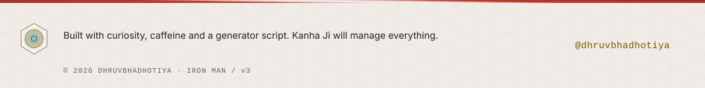</picture>

